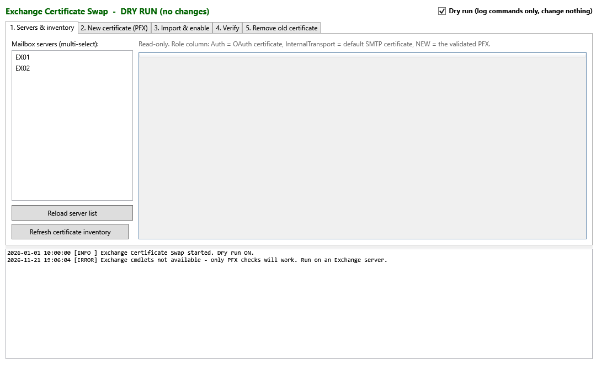
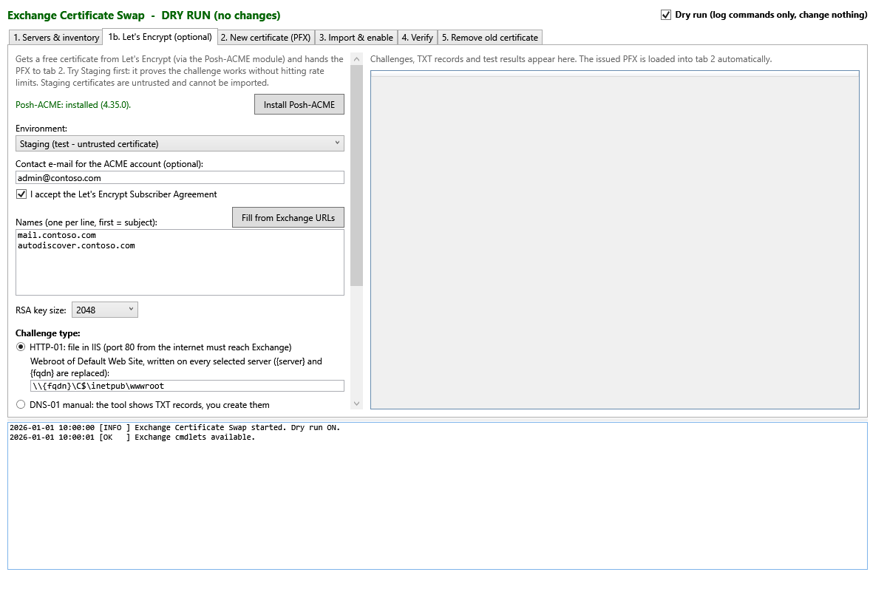

# Exchange Certificate Swap

A single-file PowerShell **WPF GUI** for replacing the public IIS/SMTP certificate on on-premises **Exchange Server 2016, 2019 and Subscription Edition** mailbox servers, using a PFX file or a free **Let's Encrypt** certificate. It covers the whole process: inventory, validation, import, enable, verification and safe removal of the old certificate. **Dry run** is on by default.



## Features

- **Let's Encrypt (optional)**: requests a certificate with the [Posh-ACME](https://poshac.me) module and passes the resulting PFX straight to validation. Proof of domain ownership, chosen per request:
  - **HTTP-01**: the tool writes the challenge file into IIS on **every** selected server, so it works behind a load balancer. It checks that each server serves the file before Let's Encrypt is asked to validate.
  - **DNS-01 manual**: the tool shows the `_acme-challenge` TXT records to create, then checks public DNS before continuing. Supports wildcards.
  - **DNS-01 automatic**: uses any of Posh-ACME's ~90 DNS provider plugins (Cloudflare, Route 53, Azure DNS, GoDaddy and more).
- **Inventory**: lists every Exchange certificate on all selected mailbox servers and marks the **Auth (OAuth)** and **internal transport** certificates.
- **Validation before changes (read-only)**:
  - the PFX contains a private key, is in its validity period and has the Server Authentication EKU
  - the chain builds to a trusted root
  - every `InternalUrl`/`ExternalUrl` on the OWA, ECP, EWS, OAB, ActiveSync and MAPI virtual directories, plus the Autodiscover SCP, is covered by the certificate's SANs (wildcards are handled correctly)
  - lists Send and Receive connectors whose `TlsCertificateName` still points to the old certificate, with the `Set-*Connector` command to fix each one
- **Import to multiple servers**: imports the **same PFX** on every selected server with `Import-ExchangeCertificate -FileData`, so the tool doesn't need to be run on each server.
- **Enable for IIS and SMTP**: if `Enable-ExchangeCertificate -Force` replaces the **internal transport certificate**, the tool restores the previous one unless you choose otherwise.
- **Verification on the network**: opens a real TLS connection to each server on port 443 and compares the served thumbprint with the new certificate. It also checks SMTP port 25 with STARTTLS (for information only) and any extra endpoints you list, such as a load balancer or public name.
- **Safe removal of the old certificate**: a certificate is removed only if:
  - its server passed verification
  - it is not the Auth or internal transport certificate
  - it is no longer bound to IIS
  - no connector points to it

  You confirm each removal.
- **Dry run by default**: every command is logged instead of being run. You turn Dry run off on purpose, and the header switches to red **LIVE MODE**.
- **Full log**: each run writes `logs\CertSwap_<timestamp>.log` next to the script. PFX passwords are never logged.
- **No private key is written to the machine that runs the tool**: the PFX is opened with `EphemeralKeySet`, so its key stays in memory. It never goes into a Windows key store or onto a smart card or hardware token. The key is installed only on the Exchange servers, through `Import-ExchangeCertificate`.

## Requirements

| | |
|---|---|
| Exchange | 2016, 2019 or Subscription Edition, **Mailbox** role |
| Where to run | Any Exchange mailbox server, **or** a machine with the Exchange Management Tools installed |
| PowerShell | **Windows PowerShell 5.1** (`powershell.exe`, not PowerShell 7), run as administrator |
| .NET Framework | 4.7.2 or newer |
| Permissions | Organization Management (or a role that can manage Exchange certificates, connectors and transport services) |
| Network | From the machine running the tool to each server's FQDN on TCP 443 (and 25 for the SMTP check) |
| Certificate | A PFX (`.pfx`/`.p12`) **with private key**, ideally including the intermediate CA certificates, **or** Let's Encrypt (see below) |
| Let's Encrypt only | The [Posh-ACME](https://www.powershellgallery.com/packages/Posh-ACME) module (the tool can install it), outbound HTTPS to `acme-v02.api.letsencrypt.org`, and public DNS names. HTTP-01 also needs inbound port 80 from the internet to the Exchange servers and admin share access (`\\server\C$`) to each server. |

**Not supported:** Edge Transport servers (they aren't in Active Directory; import their certificate locally and recreate the Edge subscription), and Exchange 2013 or older.

## Quick start

1. Download `ExchangeCertTool.ps1` and copy it to an Exchange server.
2. If Windows blocked the download, unblock the file: `Unblock-File .\ExchangeCertTool.ps1`
3. Open **Windows PowerShell as administrator** and run:

   ```powershell
   powershell.exe -STA -ExecutionPolicy Bypass -File .\ExchangeCertTool.ps1
   ```

   The tool loads the Exchange Management Shell by itself. You can also start it from an existing EMS window.

## Step-by-step

> Keep **Dry run** ticked for your first pass and read the log. Then untick it and repeat the steps that change things (3 and 5).

| Tab | What happens | Changes anything? |
|---|---|---|
| **1. Servers & inventory** | Select the mailbox servers to work on (all are selected by default). Review the current certificates. | No |
| **1b. Let's Encrypt** *(optional)* | Request a certificate instead of bringing a PFX. See [Let's Encrypt](#lets-encrypt) below. When it is issued, the PFX is loaded into tab 2 and validated automatically. | Yes (unless Dry run) |
| **2. New certificate (PFX)** | Browse to the PFX, enter its password and click **Validate**. Read the report. Missing host names and connectors that point to the old certificate appear as warnings. | No |
| **3. Import & enable** | **Step A**: import the PFX on all selected servers. **Step B**: enable it for IIS and SMTP. The old certificate stays on the servers. | Yes |
| **4. Verify** | Checks that Exchange has the new certificate enabled for IIS and SMTP and that it is served on port 443. You can add extra endpoints, such as `mail.contoso.com` or a load balancer address, to check too. | No |
| **5. Remove old certificate** *(optional)* | Click **Load candidates**. The `Blockers` column shows why a certificate can't be removed yet. Select the rows to remove and confirm. | Yes |

After step 3, update any connectors reported on tab 2 with the command the tool shows. Then load the candidates on tab 5 again.

## Let's Encrypt



1. Click **Install Posh-ACME** if the module is missing. It installs for the current user from the PowerShell Gallery.
2. Keep **Environment = Staging** for the first run. Staging uses the full validation process but issues an untrusted certificate. The tool refuses to import staging certificates.
3. Tick the Subscriber Agreement. The e-mail address is optional.
4. Click **Fill from Exchange URLs** to take the public host names from the virtual directories and the Autodiscover names that exist in public DNS. Internal names such as `.local` are skipped. Edit the list if needed.
5. Choose a challenge type:

   | Challenge | Use when | Notes |
   |---|---|---|
   | **HTTP-01** | Port 80 for your mail names reaches the Exchange servers (directly or through a load balancer) | Click **Test HTTP-01 setup** first. It writes a test file to each server's webroot (default `\\{fqdn}\C$\inetpub\wwwroot`), requests it with the certificate name as Host header, and reports redirects, `Require SSL` and 404 errors. A `web.config` in `/.well-known/acme-challenge/` turns off HTTP redirects for that folder only. No wildcards. |
   | **DNS-01 manual** | Port 80 is closed, or you need a wildcard | Click **Request certificate**. Create the TXT records shown, click **Check DNS records** until all are visible, then click **Continue (records added)**. |
   | **DNS-01 automatic** | Your DNS host has an API | Pick a plugin, click **Show parameters**, and enter the arguments as `Name=Value` lines. Put `secure:` before secrets, for example `CFToken=secure:xxxx`. Secrets are never written to the log. |

6. Click **Request certificate**, with Dry run unticked. When the certificate is issued, the tool removes the challenge files or records and opens tab 2 with the PFX already validated. Then continue with tab 3 as usual.
7. When it works on Staging, switch to **Production** and request again.

Posh-ACME keeps the account, the orders and the issued files in `%LOCALAPPDATA%\Posh-ACME` for the user who ran the tool. The log shows the PFX path. The PFX password is stored with the order: `(Get-PAOrder <name>).PfxPass`.

**Renewal:** Let's Encrypt certificates are valid for 90 days at most, and shorter in future. Run the tool again about every 60 days: request, validate, import and enable on tabs 1b to 4, then remove the old certificate on tab 5. Renewal is not automatic.

**Rate limits:** Production allows 5 duplicate certificates per week and 50 certificates per registered domain per week. Test on Staging first.

## Things to know

- **Port 443 still serves the old certificate after enabling.** Check the HTTPS binding on *Default Web Site* in IIS Manager. If the binding is correct, run `iisreset /noforce` during a quiet period.
- **Port 25 still shows the old or self-signed certificate.** This is often expected. Exchange chooses the SMTP certificate by matching the receive connector's FQDN, so a connector using the server's own internal name keeps the self-signed certificate. Internet SMTP uses the name on your public MX connector.
- **Internal names such as `.local`**: public CAs can't issue certificates for them. Change the `InternalUrl` values to a public name that is on the certificate, and use split DNS. The tool lists these names during validation.
- **Load balancers or reverse proxies that terminate TLS** (HAProxy, F5, KEMP, NGINX and so on) need the new certificate installed on them separately. Add their address on tab 4 to check it.
- **Hybrid deployments**: if your *Outbound to Office 365* connector or the receive connectors point to the old certificate, update them before removing it, and rerun the Hybrid Configuration Wizard if your process requires it.
- **Let's Encrypt HTTP-01 fails with 403**: *Require SSL* is set on the root of *Default Web Site*. Use DNS-01, or allow HTTP for `/.well-known/acme-challenge` only.
- The **Exchange Back End** site (port 444) and the **Auth certificate** are never changed by this tool.

## Testing without Exchange

Dot-source the script with `-LoadOnly`. This defines the functions and builds the window without connecting to Exchange or showing it, so you can supply mock Exchange cmdlets:

```powershell
. .\ExchangeCertTool.ps1 -LoadOnly -LogDirectory $env:TEMP\certtool
```

> ⚠️ Don't create test certificates with `New-SelfSignedCertificate` or `Import-PfxCertificate` on a workstation that has a smart card or USB token middleware installed (e.g. SafeNet Authentication Client). The private key can end up on the token. Use a lab VM for tests.

## Parameters

| Parameter | Description |
|---|---|
| `-LogDirectory <path>` | Folder for log files. Default: `.\logs` next to the script |
| `-LoadOnly` | Load the functions and build the window without connecting to Exchange or showing it (for testing) |

## Disclaimer

The tool changes production Exchange configuration. Test in a lab first, use Dry run, keep the old certificate and PFX until you have verified the change, and run it in a maintenance window. Provided as-is under the MIT License, without warranty.

## License

[MIT](LICENSE)
