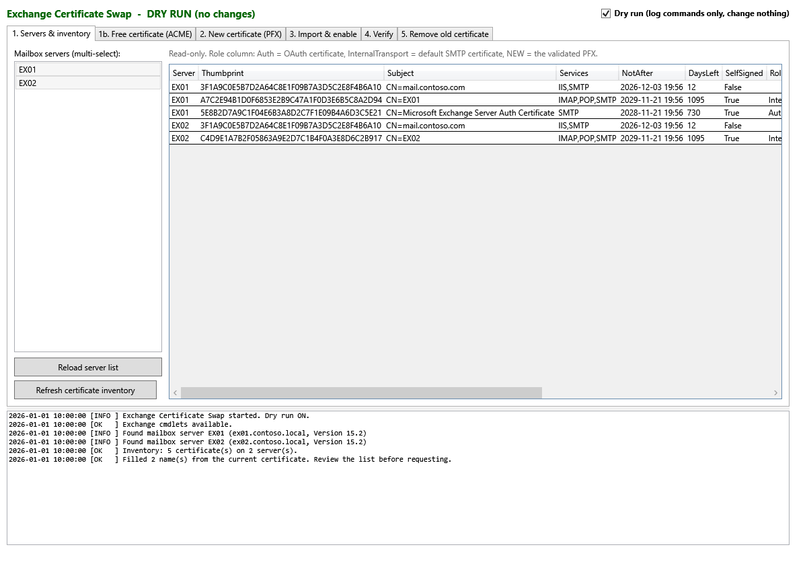

# Exchange Certificate Swap

A single-file PowerShell **WPF GUI** for replacing the public IIS/SMTP certificate on on-premises **Exchange Server 2016, 2019 and Subscription Edition** mailbox servers, using a PFX file or a **free certificate** from Let's Encrypt, ZeroSSL, Google Trust Services, SSL.com or Actalis. It covers the whole process: inventory, validation, import, enable, verification and safe removal of the old certificate. **Dry run** is on by default.



## Features

- **Free certificates (optional)**: requests a certificate from **Let's Encrypt, ZeroSSL, Google Trust Services, SSL.com or Actalis** using the [Posh-ACME](https://poshac.me) module, and passes the resulting PFX straight to validation. Proof of domain ownership, chosen per request:
  - **HTTP-01**: the tool writes the challenge file into IIS on **every** selected server, so it works behind a load balancer. It checks that each server serves the file before the CA is asked to validate.
  - **DNS-01 manual**: the tool shows the `_acme-challenge` TXT records to create, then checks public DNS before continuing. Supports wildcards.
  - **DNS-01 automatic via Cloudflare**: built-in option for domains hosted on Cloudflare DNS. You paste a scoped API token, and the tool tests it, creates and removes the TXT records itself, and can remember the token, encrypted for your Windows user. It also detects when your names are on Cloudflare DNS.
  - **DNS-01 automatic via other DNS hosts**: uses any of Posh-ACME's ~90 DNS provider plugins (Route 53, Azure DNS, GoDaddy and more).
- **Certificates from a commercial or internal CA**: creates a CSR on an Exchange server and completes it with the issued certificate. See [Commercial or internal CA (CSR)](#commercial-or-internal-ca-csr).
- **Inventory**: lists every Exchange certificate on all selected mailbox servers and marks the **Auth (OAuth)** and **internal transport** certificates. The log warns when the Auth certificate expires within 60 days or is missing on a server.
- **Auth (OAuth) certificate**: renews it, or copies it to servers that lack it. See [Auth (OAuth) certificate](#auth-oauth-certificate).
- **Validation before changes (read-only)**:
  - the PFX contains a private key, is in its validity period and has the Server Authentication EKU
  - the chain builds to a trusted root
  - every `InternalUrl`/`ExternalUrl` on the OWA, ECP, EWS, OAB, ActiveSync and MAPI virtual directories, plus the Autodiscover SCP, is covered by the certificate's SANs (wildcards are handled correctly)
  - lists Send and Receive connectors and the hybrid configuration whose `TlsCertificateName` still points to the old certificate
  - **mail flow**: the hybrid certificate name, your MX host names and their **DANE** TLSA records, and the Client Authentication EKU. See [Mail flow checks](#mail-flow-checks).
- **Import to multiple servers**: imports the **same PFX** on every selected server with `Import-ExchangeCertificate -FileData`, so the tool doesn't need to be run on each server.
- **SMTP connectors and hybrid**: updates Send and Receive connectors and the hybrid configuration (`Set-HybridConfiguration`) whose `TlsCertificateName` points to the old certificate, such as the hybrid *Outbound to Office 365* and *Default Frontend* connectors set by the HCW. It can also pin the new certificate on the **Default Frontend** connector (port 25), so internet senders get the public certificate on STARTTLS instead of the self-signed one. The connector FQDN is never changed, and rollback commands are logged.
- **Enable for IIS and SMTP** (and optionally **POP3/IMAP4**): if `Enable-ExchangeCertificate -Force` replaces the **internal transport certificate**, the tool restores the previous one unless you choose otherwise.
- **Rollback snapshots**: Steps B and C save the current configuration first, and one button restores it. See [Rollback](#rollback).
- **Edge Transport**: creates a folder with the PFX and an install script for Edge servers. See [Edge Transport servers](#edge-transport-servers).
- **Verification on the network**: opens a real TLS connection to each server on port 443 and compares the served thumbprint with the new certificate. It also checks SMTP port 25 with STARTTLS (for information only), POP3 (995) and IMAP4 (993) when the certificate is enabled for them, and any extra endpoints you list, such as a load balancer or public name. An extra endpoint that serves a different certificate is a **FAIL**: with Extended Protection, which is on by default since Exchange 2019 CU14, Windows authentication through it breaks.
- **Rolling restart**: `iisreset /noforce` and a Frontend Transport restart, one server at a time, waiting until each server answers on 443 again.
- **Automatic renewal**: `-Renew` renews a free certificate from a scheduled task and installs it on all servers. See [Automatic renewal](#automatic-renewal--renew).
- **Safe removal of the old certificate**: a certificate is removed only if:
  - its server passed verification
  - it is not the Auth or internal transport certificate
  - it is no longer bound to IIS
  - no connector points to it

  You confirm each removal.
- **Dry run by default**: every command is logged instead of being run. You turn Dry run off on purpose, and the header switches to red **LIVE MODE**.
- **Full log**: each run writes `logs\CertSwap_<timestamp>.log` next to the script (`CertRenew_<timestamp>.log` for `-Renew`). PFX passwords are never logged.
- **No private key is written to the machine that runs the tool**: the PFX is opened with `EphemeralKeySet`, so its key stays in memory. It never goes into a Windows key store or onto a smart card or hardware token. The key is installed only on the Exchange servers, through `Import-ExchangeCertificate`.

## Requirements

| | |
|---|---|
| Exchange | 2016, 2019 or Subscription Edition, **Mailbox** role |
| Where to run | Any Exchange mailbox server, **or** a machine with the Exchange Management Tools installed |
| PowerShell | **Windows PowerShell 5.1** (`powershell.exe`, not PowerShell 7), run as administrator |
| .NET Framework | 4.7.2 or newer |
| Permissions | Organization Management (or a role that can manage Exchange certificates, connectors and transport services) |
| Network | From the machine running the tool to each server's FQDN on TCP 443 (and 25 for the SMTP check, 995/993 for POP/IMAP). **PowerShell remoting** (WinRM, 5985) to each server for the Auth certificate renewal and the rolling restart. Outbound HTTPS to `dns.google` or `cloudflare-dns.com` for the DANE check (skipped if blocked). |
| Certificate | A PFX (`.pfx`/`.p12`) **with private key**, ideally including the intermediate CA certificates, **or** a free ACME certificate (see below) |
| Free certificates only | The [Posh-ACME](https://www.powershellgallery.com/packages/Posh-ACME) module (the tool can install it), outbound HTTPS to the CA's ACME server, and public DNS names. HTTP-01 also needs inbound port 80 from the internet to the Exchange servers and admin share access (`\\server\C$`) to each server. |

**Not supported:** Exchange 2013 or older. Edge Transport servers aren't in Active Directory, so the tool can't reach them; it creates an [install package](#edge-transport-servers) for them instead.

## Quick start

1. Download `ExchangeCertTool.ps1` and copy it to an Exchange server.
2. If Windows blocked the download, unblock the file: `Unblock-File .\ExchangeCertTool.ps1`
3. Open **Windows PowerShell as administrator** and run:

   ```powershell
   powershell.exe -STA -ExecutionPolicy Bypass -File .\ExchangeCertTool.ps1
   ```

   The tool loads the Exchange Management Shell by itself. You can also start it from an existing EMS window.

## Step-by-step

> Keep **Dry run** ticked for your first pass and read the log. Then untick it and repeat the steps that change things (3 and 5).

| Tab | What happens | Changes anything? |
|---|---|---|
| **1. Servers & inventory** | Select the mailbox servers to work on (all are selected by default). Review the current certificates. **Renew / copy Auth certificate** handles the OAuth certificate; see [Auth (OAuth) certificate](#auth-oauth-certificate). | No (except the Auth button) |
| **1b. Free certificate (ACME)** *(optional)* | Request a free certificate instead of bringing a PFX. See [Free certificates](#free-certificates-acme) below. When it is issued, the PFX is loaded into tab 2 and validated automatically. | Yes (unless Dry run) |
| **2. New certificate** | Browse to the PFX, enter its password and click **Validate**. Read the report. Missing host names, connectors that point to the old certificate and [mail flow problems](#mail-flow-checks) appear as warnings. If you don't have the PFX, there are other ways to pick the certificate; see [Certificate already issued or installed](#certificate-already-issued-or-installed) and [Commercial or internal CA (CSR)](#commercial-or-internal-ca-csr). | No (except the CSR buttons) |
| **3. Import & enable** | **Step A**: import the PFX on all selected servers. **Step B**: enable it for IIS and SMTP, and for POP3/IMAP4 if you tick that option. **Step C**: update the SMTP connectors and the hybrid configuration (see [SMTP connectors](#smtp-connectors-default-frontend)). The old certificate stays on the servers. Below the steps: [Roll back from snapshot](#rollback) and [Create Edge Transport package](#edge-transport-servers). | Yes |
| **4. Verify** | Checks that Exchange has the new certificate enabled for IIS and SMTP and that it is served on port 443 (and 995/993 for POP/IMAP). You can add extra endpoints, such as `mail.contoso.com` or a load balancer address, to check too; they must serve the new certificate. **Rolling restart** restarts IIS and Frontend Transport one server at a time if a server still serves the old certificate. | No (except Rolling restart) |
| **5. Remove old certificate** *(optional)* | Click **Load candidates**. The `Blockers` column shows why a certificate can't be removed yet. Select the rows to remove and confirm. | Yes |

## Certificate already issued or installed

If you closed the tool after issuing or enabling a certificate, for example before you knew about Step C, you don't need to request it again. Tab 2 has two ways to pick it up:

- **Load last Let's Encrypt/ACME certificate** finds the certificates Posh-ACME saved for the current Windows user, in `%LOCALAPPDATA%\Posh-ACME\…\fullchain.pfx` (or `POSHACME_HOME` if set). It loads the newest one with its saved PFX password and validates it. The log lists all the certificates it found, newest first.
- **Or installed → Use installed certificate** uses a certificate that is **already in Exchange**. The list contains every CA-issued certificate on the selected servers, with the one bound to IIS and expiring last at the top. No PFX is needed. You can then run Step B or Step C on tab 3, **Verify** on tab 4 and **Remove old** on tab 5 as usual.
  - If the certificate is installed on only some of the servers, **Step A** copies it to the others. It does this with `Export-ExchangeCertificate` from a server where the private key is **exportable**. If the key isn't exportable, which is the default, Step A says so, and you need the original PFX: use **Load last Let's Encrypt/ACME certificate**, or tick *Mark private key as exportable* the next time you import.

## Commercial or internal CA (CSR)

For a certificate from DigiCert, Sectigo, GlobalSign and so on, or from your own AD CS, tab 2 has **Or CSR**:

1. Enter the names in the names list on **tab 1b** (the first one becomes the subject CN). Unlike ACME, internal names are allowed here, for internal CAs.
2. Click **Create CSR (names from tab 1b)...** and choose where to save the `.req` file. The key pair is created on the **first selected server**, with an exportable private key, so Step A can copy the issued certificate to the other servers later.
3. Submit the `.req` to your CA. For AD CS, the log shows the `certreq -submit -attrib "CertificateTemplate:WebServer" …` command.
4. Click **Complete pending request (.cer / .p7b)...** and pick the issued file (`.cer`, `.crt`, `.p7b` or `.pem`; not a PFX). The tool finds the server whose pending request has the same CN, imports the certificate there, checks that it has its private key, and then uses it like **Use installed certificate**. Continue with tab 3.

If the CA sent an intermediate certificate, it must be in the *Intermediate Certification Authorities* store of every server. The chain check on tab 2 shows whether it's missing.

## Auth (OAuth) certificate

Exchange signs OAuth tokens with the self-signed *Microsoft Exchange Server Auth Certificate*. It is valid for 5 years, and when it expires or is missing on a server, OWA/ECP sign-in, hybrid free/busy and other OAuth features fail. The inventory on tab 1 logs a warning when it expires within 60 days or is missing on a selected server.

**Renew / copy Auth certificate...** on tab 1:

| Situation | What it does |
|---|---|
| Valid for 60 days or more, on every selected server | Nothing |
| Valid for 60 days or more, missing on some selected servers | Copies it there (`Export-ExchangeCertificate` / `Import-ExchangeCertificate`) |
| `Get-AuthConfig` doesn't answer | Stops and changes nothing, because the current Auth certificate is unknown. It never treats a failed lookup as "no Auth certificate". |
| Expires within 60 days, expired or missing | Creates a new one with `New-ExchangeCertificate` on the first selected server, copies it to all selected servers, then runs `Set-AuthConfig -NewCertificateThumbprint … -NewCertificateEffectiveDate (Get-Date)`, `-PublishCertificate` and `-ClearPreviousCertificate`. Finally it restarts *MSExchangeServiceHost* and recycles the OWA and ECP app pools on each server through PowerShell remoting. |

Select **all** Exchange servers on tab 1 first; the confirmation warns about servers that aren't selected. `Set-AuthConfig` is changed only after the new certificate is on every selected server, and the log contains the rollback command. In a **hybrid** deployment, rerun the Hybrid Configuration Wizard afterwards so Exchange Online trusts the new certificate. Tab 5 never removes the current, previous or next Auth certificate.

## SMTP connectors (Default Frontend)

If a receive connector has no `TlsCertificateName`, Exchange offers the certificate that matches the **connector FQDN** on STARTTLS. On the **Default Frontend \<server\>** connector (port 25, where internet mail arrives), the FQDN is normally the server's own name, such as `ex01.contoso.local`, so senders get the server's **self-signed** certificate even after you install a public one. Opportunistic TLS still works, but partners that enforce TLS, MTA-STS, DANE and hybrid mail flow expect the public certificate.

**Step C** on tab 3 fixes this without changing the connector FQDN. Changing the FQDN on Default Frontend can break Kerberos authentication between Exchange servers, so the tool leaves it alone.

| Connector | What Step C does |
|---|---|
| Any Send or Receive connector with `TlsCertificateName` set to the **old** certificate (e.g. *Outbound to Office 365* and *Default Frontend* after running the HCW) | Switches it to the new certificate. This is needed at every Let's Encrypt renewal, because the issuing CA name changes between certificates (R10, R11, R12 …). |
| **Default Frontend** (port 25) with no `TlsCertificateName`, when its FQDN is not on the new certificate | Pins the new certificate (on by default, can be unticked) |
| **Client Frontend** (port 587, SMTP submission) | Same, but only if you tick the option |
| A frontend connector whose FQDN *is* on the new certificate | Nothing; Exchange already picks the new certificate |
| A connector pinned to some other certificate, and the backend **Default \<server\>** connector (port 2525) | Nothing |

Use **Preview connector changes** to see the plan, which is also shown after validation. Step C refuses to pin a certificate on a server where it isn't enabled for SMTP yet: run Step B first, otherwise STARTTLS stops working (event 12014). For every change, the log contains the rollback command with the previous value. After Step C, wait a few minutes for transport to pick up the change, then run **tab 4**. The *SMTP :25 STARTTLS* check passes when the new certificate is served, and fails if the connector is pinned but the old certificate is still offered.

Step C also updates the **hybrid configuration** (`Get-HybridConfiguration`) when its `TlsCertificateName` points to the old certificate, so the next HCW run doesn't put the old certificate back.

Tab 5 won't remove the old certificate while any connector still points to it.

## POP3 and IMAP4

Tick *Also enable it for POP3 and IMAP4* on tab 3 only if clients use them. Step B then enables the certificate for POP and IMAP too. If `X509CertificateName` in `Get-PopSettings`/`Get-ImapSettings` is not a name on the new certificate, the tool sets it to the first non-wildcard name (the log contains the previous value), and it restarts the POP3 and IMAP4 services that are running. Tab 4 then checks ports 995 and 993.

## Mail flow checks

Validation on tab 2 also checks things that break mail flow even though the certificate is otherwise fine. In the GUI they are warnings in the report; [automatic renewal](#automatic-renewal--renew) stops before changing Exchange.

| Check | Problem when |
|---|---|
| **Hybrid** | The CN in the hybrid configuration's `TlsCertificateName` is not on the new certificate. Exchange Online usually checks this name on mail from on-premises. |
| **MX** | An MX host of an authoritative accepted domain (up to 20 domains) is on the current certificate but not on the new one. MX hosts that aren't on either certificate, such as Exchange Online Protection or a mail gateway, are ignored. |
| **DANE** | `_25._tcp.<mx>` has TLSA records, and none matches the new certificate. The report shows the `3 1 1` record to publish. Publish it next to the existing record and wait for its TTL before Step B and C, or DANE-validating senders, including Exchange Online, stop delivering. |
| **Client Authentication EKU** (warning only) | The current certificate has it and the new one doesn't. Exchange also presents this certificate as a client on outgoing SMTP, so partners that require mutual TLS may reject it. Public CAs are phasing this EKU out. |

`Resolve-DnsName` can't query TLSA records, so the DANE check uses DNS-over-HTTPS at `dns.google`, then `cloudflare-dns.com`. If neither is reachable, the check is skipped with an INFO line.

## Rollback

Before Step B and before Step C change anything, the tool saves the current configuration to `logs\Snapshot_<timestamp>_before-StepB.json` (or `before-StepC`). The snapshot holds, per server, the IIS certificate, the internal transport certificate and the POP/IMAP `X509CertificateName`, plus the `TlsCertificateName` of all Send connectors, the Receive connectors of the selected servers and the hybrid configuration.

**Roll back from snapshot...** on tab 3 compares the current configuration with the snapshot you choose, shows the commands that restore it, and runs them after you confirm (Dry run applies). Only values that differ are changed. The new certificate stays installed. IIS can only go back to a certificate that is still installed, so keep the old certificate until you're sure: once tab 5 has removed it, the log says that IIS can't be rolled back on that server.

## Edge Transport servers

Edge servers aren't in Active Directory, so the tool can't import the certificate on them. After you validate a **PFX** on tab 2, **Create Edge Transport package...** on tab 3 creates `logs\EdgePackage_<timestamp>` with `certificate.pfx` and `Install-EdgeCertificate.ps1`. Copy the folder to each Edge server and run the script in an elevated Exchange Management Shell:

```powershell
.\Install-EdgeCertificate.ps1 -WhatIf                   # show what would happen
.\Install-EdgeCertificate.ps1                           # import (asks for the PFX password) and enable for SMTP
.\Install-EdgeCertificate.ps1 -UpdatePinnedConnectors   # also switch receive connectors pinned to another certificate
```

The script keeps the internal transport certificate, so the Edge Subscription stays valid and doesn't need to be recreated. The PFX password is not stored in the package. **Delete the folder afterwards**: it contains the private key. The package needs the PFX file, so it isn't available with *Use installed certificate*.

## Free certificates (ACME)


### Certificate authorities

| Certificate authority | Account needed | EAB credentials (first request only) | Staging available |
|---|---|---|---|
| **Let's Encrypt** | No | No | Yes |
| **ZeroSSL** | No | Yes. Click **Get from e-mail** to generate them from the contact e-mail, or copy them from *app.zerossl.com → Developer → EAB Credentials* | No |
| **Google Trust Services** | Google Cloud project | Yes. In Cloud Shell, run `gcloud services enable publicca.googleapis.com` then `gcloud publicca external-account-keys create`. Use `keyId` as the KID and `b64MacKey` as the HMAC key. The credentials expire after 7 days if unused. For **staging**, run `gcloud config set api_endpoint_overrides/publicca https://preprod-publicca.googleapis.com/` before creating them. | Yes |
| **SSL.com** (RSA) | Free SSL.com account | Yes, from the SSL.com dashboard | No |
| **Actalis** | Free Actalis account | Yes, from the Actalis dashboard | No |

EAB (External Account Binding) credentials link your ACME account to your account at the CA. They're needed only the first time: Posh-ACME keeps the account for each CA, so later requests and renewals don't need them. The HMAC key is a password field and is never written to the log.

All of these issue publicly trusted 90-day domain-validated certificates, which Exchange accepts. SSL.com's ECC endpoint is left out because Exchange needs RSA certificates. Each CA's terms and rate limits can change, so check them before relying on a CA.

### Steps

1. Click **Install Posh-ACME** if the module is missing. It installs for the current user from the PowerShell Gallery. The tool looks for the module on `PSModulePath` and also in the PowerShell 7 module folders, your Documents folders (including OneDrive and redirected Documents), Program Files, and a `Modules` folder next to the script. It then loads the module by its full path. If it still shows **NOT found**, the log lists every folder it checked. Click **Re-check** after installing it in another window.
2. Choose the **certificate authority**. For the first run, keep **Let's Encrypt - Staging** (or Google Staging). Staging uses the full validation process but issues an untrusted certificate. The tool refuses to import staging certificates.
3. Tick the subscriber agreement. The e-mail address is optional, except for **Get from e-mail** with ZeroSSL. Fill in the EAB fields if the CA needs them.
4. Check the **names**. When the tool starts, it fills them in from the CA-issued certificate currently bound to IIS on the selected servers: the subject CN comes first, then the SANs. If the servers use different certificates, their names are combined. If a name is a wildcard, the tool switches to DNS-01. If IIS only has a self-signed certificate, it uses the Exchange URLs instead. The tool never overwrites names you typed. To refill the list, use **Fill from current certificate** or **Fill from Exchange URLs**. Internal names such as `.local`, plain server names and IP addresses are always skipped.
5. Choose a challenge type:

   | Challenge | Use when | Notes |
   |---|---|---|
   | **HTTP-01** | Port 80 for your mail names reaches the Exchange servers (directly or through a load balancer) | Click **Test HTTP-01 setup** first. It writes a test file to each server's webroot (default `\\{fqdn}\C$\inetpub\wwwroot`), requests it with the certificate name as Host header, and reports redirects, `Require SSL` and 404 errors. A `web.config` in `/.well-known/acme-challenge/` turns off HTTP redirects for that folder only. No wildcards. |
   | **DNS-01 manual** | Port 80 is closed, or you need a wildcard | Click **Request certificate**. Create the TXT records shown, click **Check DNS records** until all are visible, then click **Continue (records added)**. |
   | **DNS-01 automatic: Cloudflare** | Your public DNS is on Cloudflare | See [Cloudflare DNS](#cloudflare-dns) below. Works with wildcards and with port 80 closed. |
   | **DNS-01 automatic: other provider** | Your DNS host has an API | Pick a plugin, click **Show parameters**, and enter the arguments as `Name=Value` lines. Put `secure:` before secrets, for example `CFToken=secure:xxxx`. Secrets are never written to the log. |

6. Click **Request certificate**, with Dry run unticked. When the certificate is issued, the tool removes the challenge files or records and opens tab 2 with the PFX already validated. Then continue with tab 3 as usual.
7. When it works on Staging, switch to a production CA and request again.

### Cloudflare DNS

When your public DNS is hosted on Cloudflare, the tool creates and deletes the `_acme-challenge` TXT records through the Cloudflare API. You don't need to open port 80, and wildcards work. If the names on the certificate resolve to Cloudflare nameservers, the tab shows **"Detected: … uses Cloudflare DNS"**.

1. **Create an API token.** Go to *dash.cloudflare.com → My Profile → API Tokens → Create Token* and use the **Edit zone DNS** template. It needs these permissions:
   - **Zone → DNS → Edit**
   - **Zone → Zone → Read**

   Under *Zone Resources*, choose your zone, or *All zones* if the certificate covers several. Don't use the Global API Key.
2. Select **DNS-01 automatic: Cloudflare (API token)** and paste the token. Typing a token selects this option automatically.
3. Click **Test Cloudflare token**. It checks:
   - that the token is active (for account-owned tokens this check shows INFO instead, which is expected);
   - that each name maps to a Cloudflare zone, using the deepest matching zone, so delegated sub-zones work;
   - that it can read DNS records;
   - **with Dry run off**, that it can write, by creating and immediately deleting one `_certtool-test-….<zone>` TXT record.
4. Click **Request certificate**. The same check runs again before ordering, so a bad token stops the request before the CA is contacted.

The token is never written to the log. If you tick **Remember the token**, it is stored in `%LOCALAPPDATA%\ExchangeCertTool\cloudflare-token.dpapi`, encrypted with Windows DPAPI. Only the same Windows user on the same server can decrypt it, and it is loaded again the next time the tool starts, which makes renewals quicker. Untick the box and run the test again to delete the saved token.

Proxied (orange-cloud) records don't matter, because DNS-01 only uses TXT records.

Posh-ACME keeps the account, the orders and the issued files in `%LOCALAPPDATA%\Posh-ACME` for the user who ran the tool. The log shows the PFX path. The PFX password is stored with the order: `(Get-PAOrder <name>).PfxPass`.

**Renewal:** these certificates are valid for 90 days at most, and the industry maximum keeps shrinking (47 days by 2029). Either run the tool again about every 60 days (request, validate, import and enable on tabs 1b to 4, then remove the old certificate on tab 5), or set up [automatic renewal](#automatic-renewal--renew).

**Rate limits:** Let's Encrypt production allows 5 duplicate certificates per week and 50 certificates per registered domain per week. Other CAs have their own limits. Test on Staging first.

## Automatic renewal (-Renew)

`-Renew` runs the same steps as the GUI without showing it, for a scheduled task. It renews free ACME certificates only.

**One-time setup**

1. In the GUI, as the Windows user that will run the task, request a certificate from a **production** CA with **HTTP-01**, **Cloudflare** or a **DNS plugin** (DNS-01 manual can't run unattended), with **all** mailbox servers selected. For Cloudflare, tick **Remember the token**. When the certificate is issued, the tool saves the settings to `%LOCALAPPDATA%\ExchangeCertTool\renewal.json`: CA, names, challenge type, key length, e-mail and servers. Plugin arguments are encrypted with DPAPI.
2. Try it in dry run, which logs what it would do and changes nothing:

   ```powershell
   powershell.exe -STA -ExecutionPolicy Bypass -File .\ExchangeCertTool.ps1 -Renew -ForceRenew
   ```

3. Create the scheduled task. It must run as the **same user** as step 1, because the Posh-ACME account, the Cloudflare token and the settings are stored in that user's profile, encrypted for that user:

   ```powershell
   $cred    = Get-Credential 'CONTOSO\svc-exchcert'
   $action  = New-ScheduledTaskAction -Execute 'powershell.exe' -Argument '-NoProfile -STA -ExecutionPolicy Bypass -File "C:\Scripts\ExchangeCertTool.ps1" -Renew -Live -RemoveOld -NotifyTo admin@contoso.com'
   $trigger = New-ScheduledTaskTrigger -Daily -At 3am
   Register-ScheduledTask -TaskName 'Exchange certificate renewal' -Action $action -Trigger $trigger -RunLevel Highest -User $cred.UserName -Password $cred.GetNetworkCredential().Password
   ```

   A daily run is fine: it ends at once while the current certificate has more than `-RenewDays` (30) days left.

**What a run does**

1. Checks the days left on the certificate bound to IIS on the saved servers. With 30 days or more left, it stops (exit code 0, no e-mail).
2. Reuses a certificate that an earlier run already issued but didn't install, so repeated failures don't use up the CA's rate limits. Otherwise it requests a new one with the saved settings. A certificate that is already on IIS is never reused, so `-ForceRenew` always gets a new certificate.
3. Validates it. It **stops before changing Exchange** if the new certificate no longer covers a name that the current one covers, or if a [mail flow check](#mail-flow-checks) finds a problem.
4. Runs Step A, B and C. Step C only switches connectors that are pinned to the old certificate; it doesn't pin new ones. POP/IMAP is included only if the old certificate was enabled for it. If a step logs an error, the run stops; the snapshot from Step B or C can be restored on tab 3 with **Roll back**.
5. Verifies every server, retrying once after 2 minutes.
6. With `-RemoveOld`, removes the previous IIS certificate, with the same safety checks as tab 5.
7. With `-NotifyTo`, e-mails the log (subject `[ExchangeCertTool] Certificate renewal OK|FAILED|DRYRUN on <server>`).

Without `-Live`, the run is a dry run: it stops before the ACME request (or, if it can reuse a saved certificate, after logging Steps A to C). Exit code 0 means renewed, nothing to do, or dry run; 1 means it failed. Servers added to the organization after the setup aren't included: the log warns about them, and you repeat step 1 with all servers selected.

## Things to know

- **Port 443 still serves the old certificate after enabling.** Check the HTTPS binding on *Default Web Site* in IIS Manager. If the binding is correct, click **Rolling restart...** on tab 4 during a quiet period (or run `iisreset /noforce` on each server).
- **Port 25 still shows the old or self-signed certificate.** Run tab 3, Step C, which pins the new certificate on *Default Frontend*. If tab 4 still shows the old certificate a few minutes after Step C, restart the *Microsoft Exchange Frontend Transport* service during a quiet period.
- **Internal names such as `.local`**: public CAs can't issue certificates for them. Change the `InternalUrl` values to a public name that is on the certificate, and use split DNS. The tool lists these names during validation.
- **Load balancers or reverse proxies that terminate TLS** (HAProxy, F5, KEMP, NGINX and so on) need the new certificate installed on them separately. Add their address on tab 4 to check it. With Extended Protection on (the default since Exchange 2019 CU14), they must serve the **same** certificate as Exchange, or Windows authentication through them fails, so tab 4 reports a different certificate as FAIL.
- **Hybrid deployments**: Step C updates the connectors and the hybrid configuration that point to the old certificate. Rerun the Hybrid Configuration Wizard if your process requires it.
- **Posh-ACME shows "NOT found" although you installed it**: check the folder list in the log. Common causes are installing it from PowerShell 7 (`pwsh`) as a *different* user than the one running the tool, or a server with no internet access. For offline servers, run `Save-Module Posh-ACME -Path .\Modules` on another machine and copy the `Modules` folder next to `ExchangeCertTool.ps1`. If loading fails because of the execution policy, the log shows the policy that applies.
- **HTTP-01 fails with 403**: *Require SSL* is set on the root of *Default Web Site*. Use DNS-01, or allow HTTP for `/.well-known/acme-challenge` only.
- The **Exchange Back End** site (port 444) is never changed. The **Auth certificate** changes only when you click **Renew / copy Auth certificate** on tab 1.

## Testing without Exchange

`tests\Test-ExchangeCertTool.ps1` runs the tool against mock Exchange cmdlets (two servers, sample certificates and connectors). It needs no Exchange and no network, and it doesn't create certificates or keys. It covers the inventory, validation of an installed certificate, the mail flow checks, Steps B and C, snapshots and rollback, the Auth certificate, the Edge package and an unattended renewal. It prints PASS/FAIL per check and exits with 1 if any check fails:

```powershell
powershell.exe -NoProfile -STA -ExecutionPolicy Bypass -File .\tests\Test-ExchangeCertTool.ps1
```

For your own experiments, dot-source the script with `-LoadOnly`. This defines the functions and builds the window without connecting to Exchange or showing it, so you can supply mock Exchange cmdlets:

```powershell
. .\ExchangeCertTool.ps1 -LoadOnly -LogDirectory $env:TEMP\certtool
```

> ⚠️ Don't create test certificates with `New-SelfSignedCertificate` or `Import-PfxCertificate` on a workstation that has a smart card or USB token middleware installed (e.g. SafeNet Authentication Client). The private key can end up on the token. Use a lab VM for tests.

## Parameters

| Parameter | Description |
|---|---|
| `-LogDirectory <path>` | Folder for log files. Default: `.\logs` next to the script |
| `-LoadOnly` | Load the functions and build the window without connecting to Exchange or showing it (for testing) |
| `-Renew` | [Automatic renewal](#automatic-renewal--renew) without the GUI, for a scheduled task. Dry run unless `-Live` is given |
| `-Live` | With `-Renew`: make the changes |
| `-RemoveOld` | With `-Renew`: remove the previous IIS certificate after every server passed verification |
| `-RenewDays <n>` | With `-Renew`: renew when the current certificate has fewer days left. Default: 30 |
| `-ForceRenew` | With `-Renew`: request a new certificate now, whatever the days left (never reuses the one on IIS) |
| `-NotifyTo <address[]>` | With `-Renew`: e-mail the log to these addresses when a renewal ran, failed or was a dry run |
| `-NotifyFrom <address>` | With `-Renew`: sender address. Default: `ExchangeCertTool@<default accepted domain>` |
| `-SmtpServer <host>` | With `-Renew`: SMTP server for the e-mail. Default: `localhost` (the Exchange server itself) |

## Disclaimer

The tool changes production Exchange configuration. Test in a lab first, use Dry run, keep the old certificate and PFX until you have verified the change, and run it in a maintenance window. Provided as-is under the MIT License, without warranty.

## License

[MIT](LICENSE)
